# Netflix
Пародия на реальное приложение Netflix

Пет-проект, повторяющий структуру и основные сценарии приложения Netflix — с собственным дизайном и урезанным функционалом. Гибридное приложение на **UIKit + SwiftUI** с архитектурой **MVVM+C**, полной поддержкой **офлайн-режима** (Core Data + FileManager) и авторизацией через **Firebase Auth**.

> 📱 Поддерживается **только портретная ориентация**.

---

## ✨ Возможности
- **Splash-экран** — иконка Netflix по центру с лоадером, без логики
- **Onboarding** — показывается один раз, предлагая войти или зарегистрироваться
- **Авторизация и регистрация** - Firebase Auth с валидацией полей
- **Авто-вход** — при наличии активного пользователя Auth-flow пропускается
- **Home** — просмотр наиболее популярного фильма, а также горизонтальная лента Popular Movies наиболее актуальных и популярных фильмов на данный момент. Пагинация запроса (по 20 фильмов на страницу)
- **Coming Soon** — просмотр списка фильмов, которые еще не были опубликованы. Также возможно произвести поиск по названию фильма. Пагинация запроса (по 20 фильмов на страницу)
- **Favorites** — просмотр списка фильмов, добавленных в Избранные.
- **Movie Details** — просмотр подробной информации о данном фильме, а также список фильмов, которые как-либо связаны с текущим. Пагинация запроса (по 20 фильмов на страницу)
- **Profile** — данные пользователя, очистка кэша, Log out

## 🗺 Архитектура и навигация

Приложение построено на **MVVM+C**. 

`AppCoordinator` управляет всем flow:
```
Splash → Onboarding (первый запуск) → Auth (Login / Register)
                                              ↓
              TabBarController: Home · Coming Soon · Favorites
                                              ↓
                               Movie Details · Profile
```

## 🧩 Технологии
- **TMDB API** — Источник данных о фильмах
- **MVVM+C** — Архитектура: разделение слоёв + координаторы для управления flow
- **UIKit** — Экраны Splash, Onboarding, Login, Register
- **SnapKit** — Удобные констрейнты на UIKit-экранах
- **SwiftUI** — Основные экраны: Home, Coming Soon, Favorites, Movie Details, Profile
- **Alamofire** — Сетевые запросы к TMDB API
- **async/await** — Асинхронная работа с сетью и background слоем
- **Core Data** — Локальная база фильмов и работа в офлайн-режиме
- **FileManager** — Сохранение и чтение скачанных картинок фильмов
- **NSCache** — Временный кэш последних 100 загруженных картинок
- **SwiftGen** — Генерация типизированных ресурсов: Assets, Strings, Colors
- **SwiftLint** — Контроль стиля и качества кода
- **Firebase Auth** — Регистрация, вход и проверка активного пользователя
- **Swift Package Manager (SPM)** — Менеджер зависимостей: Alamofire, Firebase Auth, SnapKit


## 📱 Экраны

### 🌊 Splash — UIKit
*Технологии:* `UIKit` · `MVVM+C`

<details>
  <summary>Смотреть скриншоты Splash</summary>

<p align="center">
  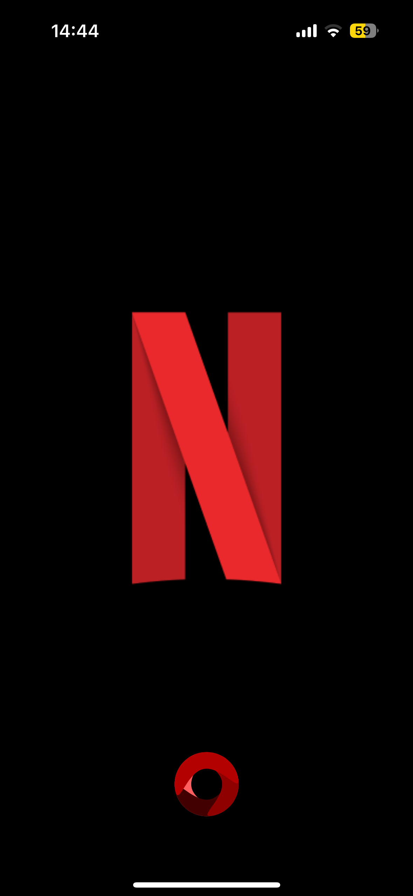
</p>
</details>

### 👋 Onboarding — UIKit
*Технологии:* `UIKit` · `UserDefaults` · `MVVM+C`

<details>
  <summary>Смотреть скриншоты Onboarding</summary>

<p align="center">
  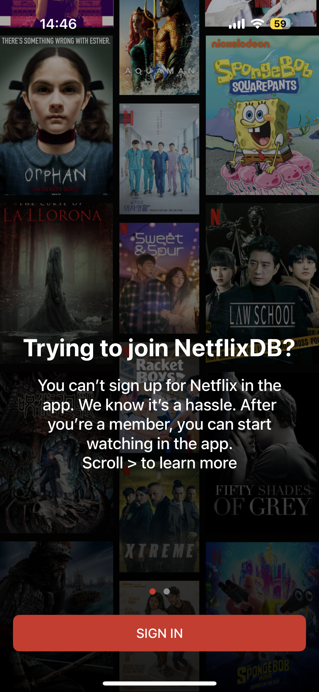
  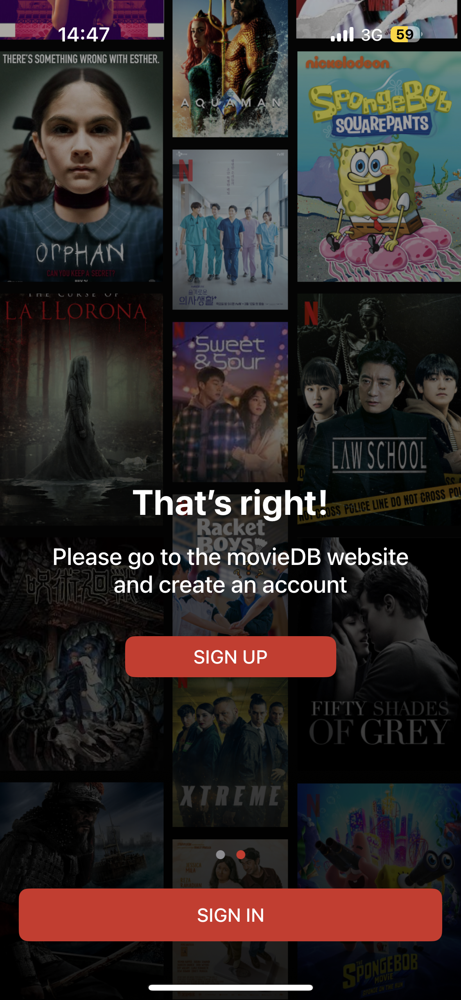
</p>
</details>

### 🔐 Login / Register — UIKit
*Технологии:* `UIKit` · `Firebase Auth` · `MVVM+C`

<details>
  <summary>Смотреть скриншоты Login/Register</summary>
  
<p align="center">
  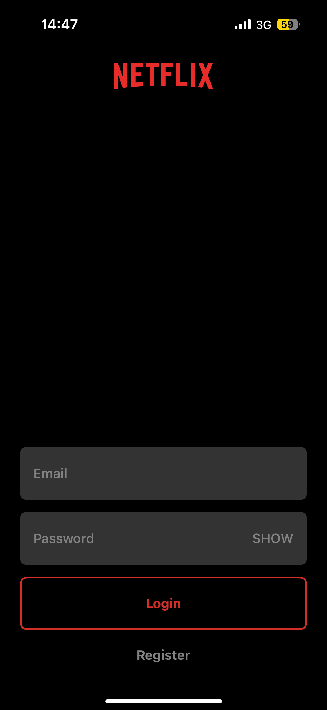
  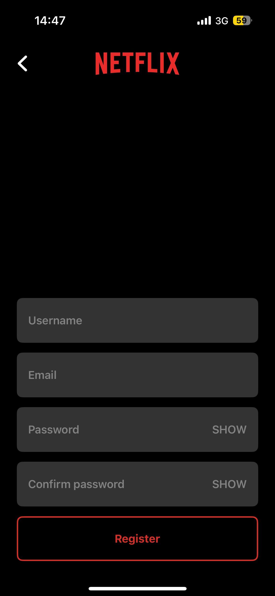
</p>
</details>

### 🏠 Home — SwiftUI
*Технологии:* `SwiftUI` · `Alamofire / TMDB API` · `async/await` · `Core Data` · `FileManager` · `NSCache` · `MVVM+C`

<details>
  <summary>Смотреть скриншоты Home</summary>
  
<p align="center">
  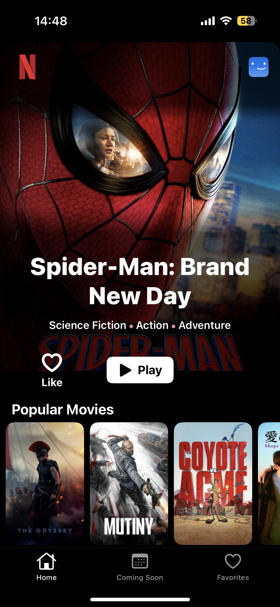
</p>
</details>

### 📅 Coming Soon — SwiftUI
*Технологии:* `SwiftUI` · `Alamofire / TMDB API` · `async/await` · `Core Data` · `FileManager` · `MVVM+C`

<details>
  <summary>Смотреть скриншоты Coming Soon</summary>
  
<p align="center">
  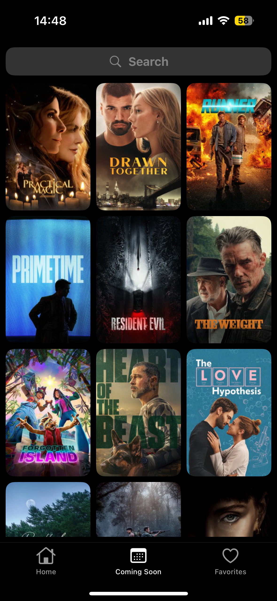
</p>
</details>

### ❤️ Favorites — SwiftUI
*Технологии:* `SwiftUI` · `Core Data` · `MVVM+C`

<details>
  <summary>Смотреть скриншоты Favorites</summary>
  
<p align="center">
  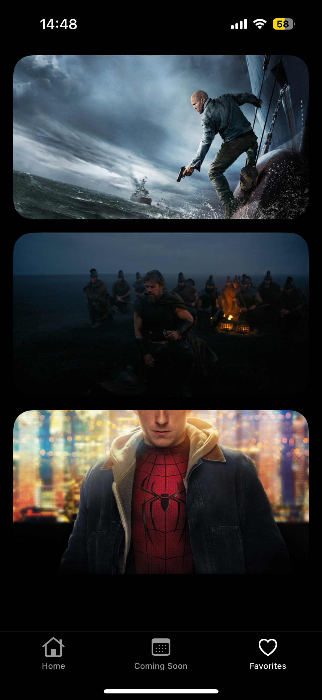
</p>
</details>

### 🎬 Movie Details — SwiftUI
*Технологии:* `SwiftUI` · `Alamofire / TMDB API` · `async/await` · `Core Data` · `FileManager` · `NSCache` · `MVVM+C`

<details>
  <summary>Смотреть скриншоты Movie Details</summary>
  
<p align="center">
  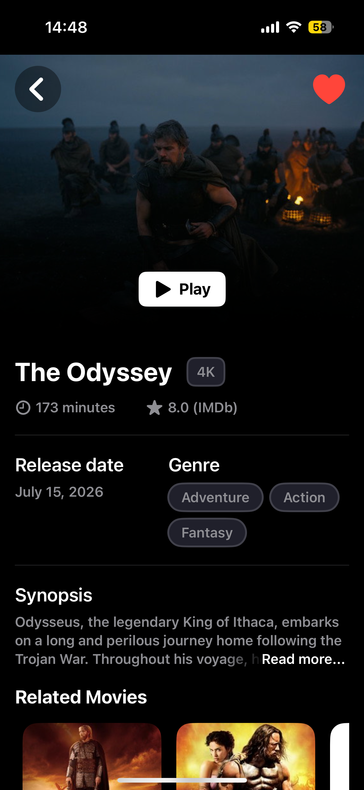
</p>
</details>

### 👤 Profile — SwiftUI
*Технологии:* `SwiftUI` · `Firebase Auth` · `Core Data` · `FileManager` · `URLCache` · `MVVM+C`

<details>
  <summary>Смотреть скриншоты Profile</summary>
  
<p align="center">
  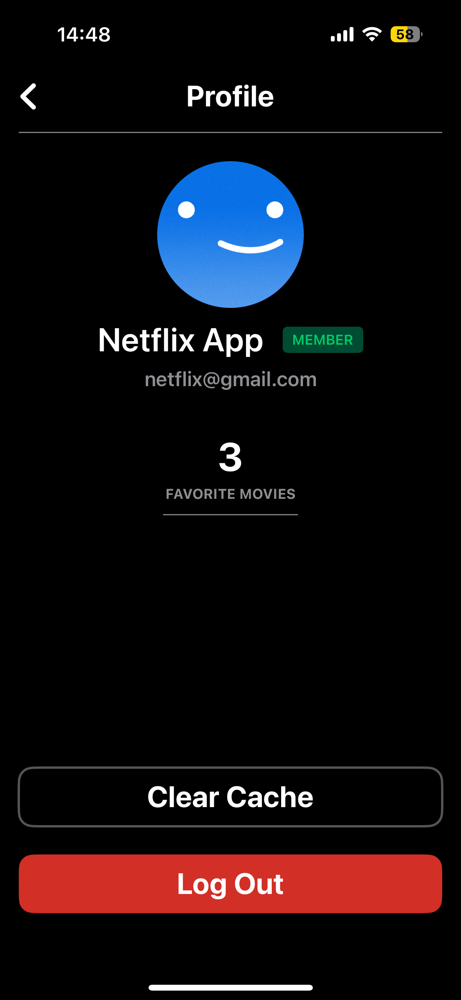
</p>
</details>

### 🛜 Отсутствие сети — при отсутствии стабильной сети появляется небольшой "баннер", который говорит вам об этом.
*Технологии:* `SwiftUI` · `NWPathMonitor`

<details>
  <summary>Смотреть скриншоты No Network</summary>
  
<p align="center">
  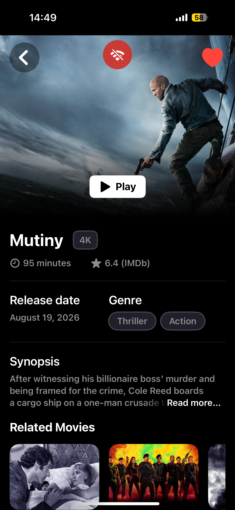
</p>
</details>

## 🚀 Требования и запуск
- Xcode 16+
- iOS 18.0+
- Доступ к **TMDB API** (вставьте свой ключ), также имейте в виду, что API доступен не из всех стран
- Настроенный проект **Firebase** (GoogleService-Info.plist, включён Auth)
- TMBD API доступен не из всех стран, имейте в виду

## 📜 Лицензия
Проект создан в учебных целях. Все права на контент и бренд Netflix принадлежат их владельцам.
